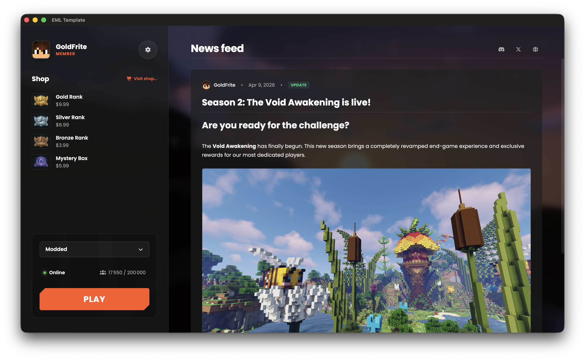

# EML Template

**EML Template is the reference boilerplate for building a modern, fast, and cross-platform Minecraft Launcher.**

Powered by <a href="https://github.com/Electron-Minecraft-Launcher/EML-Lib-v2"><b>EML Lib</b></a> • Configurable via <a href="https://github.com/Electron-Minecraft-Launcher/EML-AdminTool-v2"><b>EML AdminTool</b></a>



[<p align="center">](https://emlproject.com/discord/github)
[](#platforms)
[](package.json)</p>

<p>
<center>
<a href="https://emlproject.com/discord/github">
  
</a>
</center>
</p>

---

## Introduction

**EML Template** acts as the frontend foundation for the _Electron Minecraft Launcher_ ecosystem. It is a pre-configured **Electron + Vite** application designed to provide the best possible gaming experience.

It is engineered to work in perfect synergy with **EML Lib** (for the core logic) and **EML AdminTool** (for configuration).

## Features

- **Next-gen performance**: Built on **Vite**, offering instant startup and Hot-Module-Replacement (HMR).
- **Microsoft authentication**: Full integration of the official authentication flow via EML Lib.
- **Asset management**: Smart downloading of game files (Java, libraries, assets, mods) with hash validation, thanks to EML Lib and EML AdminTool (optional).
- **Auto-update**: Automatic update system linked to your EML AdminTool instance.
- **Skin & cape management**: View and equip skins and capes directly from the launcher.
- **Player Sync authentication**: Sign in to the Sync service with an online Microsoft account that owns Minecraft Java.

## Installation & Development

### Prerequisites

Before starting, ensure you have installed:

- **Node.js** (v18 or higher recommended)
- **npm** (or Yarn/Pnpm)

### Setup

1.  Clone the repository:

    ```bash
    git clone https://github.com/Electron-Minecraft-Launcher/EML-Template.git
    cd EML-Template
    ```

2.  Install dependencies:

    ```bash
    npm install
    ```

    _Note: This will automatically install `eml-lib` and build tools._

3.  Start in Development mode:

    ```bash
    npm run dev
    ```

    An Electron window will open with hot-reloading enabled.

## Configuration

### Link to your EML AdminTool instance

Modify the configuration file (`electron/const.ts`) to point to your distribution URL generated by **EML AdminTool**.

> [!TIP]
> Since EML Lib v2.2.0, you can use EML Template without an EML AdminTool instance by providing a custom configuration object directly in the code. However, using EML AdminTool is recommended for easier management and updates.

### Player Sync authentication

Enabling Player Sync performs a handshake with the AdminTool configured in `electron/const.ts`. The launcher sends the Microsoft Minecraft access token only from Electron's main process; the returned Sync token stays in memory and is not sent to the renderer or saved to disk. A stable random device ID is stored in Electron's `userData` directory.

The AdminTool must set `SYNC_ENABLED=true`, configure `JWT_SECRET_KEY` with at least 32 bytes, and provision an enabled Sync profile with include rules. The player must use an online Microsoft account with Minecraft Java access. This integration implements authentication only; it does not yet upload the selected local files.

### Icon customization

To change the visual identity, replace the files in the `build/` folder:

- `icon.png`: Standard icon (512x512).
- `icon.ico`: For Windows.
- `icon.icns`: For macOS (Legacy & Liquid Glass fallback).
- `background.png`: DMG Installer background (macOS).

### Build (distribution)

To create the final executables for distribution:

| Platform | Command               | Output format               |
| -------- | --------------------- | --------------------------- |
| Windows  | `npm run release:win` | `.exe` (NSIS Installer)     |
| macOS    | `npm run release:mac` | `.dmg` (Disk Image)         |
| Linux    | `npm run release:lin` | `.AppImage`, `.deb`, `.rpm` |

Compiled files will be located in the `release/` folder.

## Contributing

Contributions are welcome! For major changes, please open an issue first to discuss what you would like to change.
